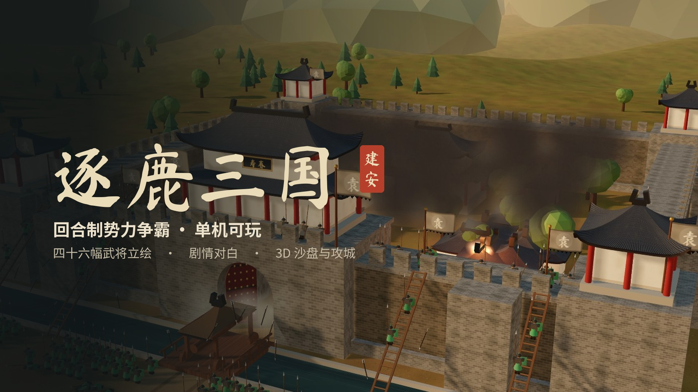

# 逐鹿三国 · 游戏合集

| 目录 | 是什么 |
| --- | --- |
| [逐鹿三国](逐鹿三国/) | 三国题材的回合制势力争霸游戏，网页版。双击 `index.html` 就能玩 |
| [游戏合集小程序](游戏合集小程序/) | 微信小程序：游戏大厅 + 逐鹿三国 + 仓库推箱子 3D，用微信开发者工具导入即可 |

## 逐鹿三国

建安五年，官渡前夜。选一位君主（曹操、袁绍、孙策、刘备），每季给每位武将下一道命令：开发、征兵、训练、出征、调动、搜索、登用、外交。天下共 22 城，先得 15 城者胜。

- 介绍视频：[逐鹿三国/视频/逐鹿三国-介绍.mp4](逐鹿三国/视频/逐鹿三国-介绍.mp4)（1 分 28 秒，真实对局逐帧录制剪辑）
- 46 位武将全身立绘、视觉小说式剧情对白、3D 沙盘视角、3D 攻城动画（Three.js）
- 规则（`rules.js`）、电脑 AI 和军师进言（`ai.js`）、剧本数据（`data.js`）和界面（`ui.js`）分开写，小程序版直接复用前三个文件
- `tools/` 里有平衡性模拟、胜算校准、自动试玩截图，以及制作介绍视频的脚本，用法见 [逐鹿三国/README.md](逐鹿三国/README.md)

## 游戏合集小程序

首页是游戏大厅，两个游戏各是一个分包。项目里的 AppID 是测试号，只能自己开发和体验；微信规定游戏要用「小游戏」账号发布，所以这个合集不能正式上架。详见 [游戏合集小程序/README.md](游戏合集小程序/README.md)。

## 第三方内容

- 书法字体：马善政毛笔楷书（Ma Shan Zheng），SIL Open Font License 1.1，小程序里只内嵌了用到的 225 个字，许可见 `游戏合集小程序/miniprogram/common/OFL.txt`
- Three.js r160（推箱子 3D 场景），MIT 许可，见 `游戏合集小程序/miniprogram/sokoban/vendor/THREE-LICENSE.txt`
- Three.js r160（逐鹿三国网页版的 3D 沙盘和攻城动画），MIT 许可，见 `逐鹿三国/vendor/THREE-LICENSE.txt`
- 介绍视频的配乐由代码合成（`逐鹿三国/tools/video_music.py`），没有使用外部音乐素材
